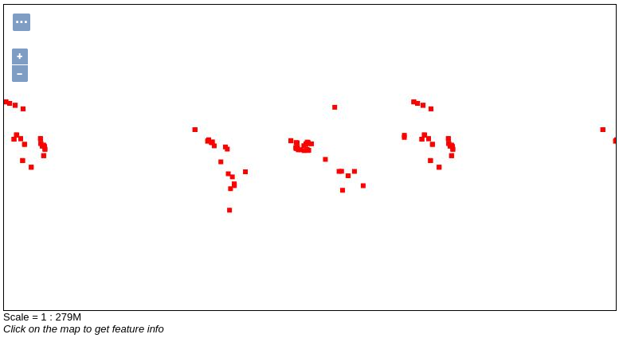

## Objectifs de la session

- Apprendre ce qu’est un serveur cartographique.

- Connaître les standards OGC WFS, WMS, WMTS…

- Savoir importer, styliser et visualiser une couche de données dans GeoServer.

*Durée : 2h*

## Supports

[Cours : Introduction à GeoServer](./03_diapos_geoserver.qmd){target="_blank"}

## ️TP - Prise en main de GeoServer

### Déploiement de GeoServer à l’aide de Docker

[Documentation GeoServer](https://docs.geoserver.org/main/en/user/installation/docker.html) - [Dépôt de l’image Docker](https://github.com/geoserver/docker)

::: callout-important
Ce TP suppose que Docker est installé sur la machine ou que le *codespace* sur GitHub a bien été mis en place. Il a été écrit pour une machine Linux, certains chemins et lignes de commande peuvent donc être différents sur une machine Windows ou Mac.
:::

Si tout s’est bien passé lors du TP précédent, vous devriez avoir une instance de GeoServer qui tourne à l’adresse <http://localhost:8080/geoserver/web/?0> (si vous êtes sur votre machine) ou bien sur le port indiqué dans votre GitHub Codespaces.

::: {.callout-note collapse="true"}
## Je ne trouve pas mon GeoServer

Pour relancer votre instance, vous pouvez :

- ouvrir un terminal à la racine du dossier `geonum_docker` et taper la commande `docker compose up -d`
- ouvrir l’application Docker Desktop, trouver la *stack* de containers `geonum_docker` et `geonum_web` et cliquer sur "Start"
- ouvrir l’onglet *Containers* de votre VSCode (fonctionne avec GitHub Codespaces) et lancer avec le bouton "play" les containers `geonum_docker` et `geonum_web`.

**Pour ceux qui ont perdu leur *codespace* :**

Allez sur votre dépôt et cliquez sur ***\<\> Code***, puis allez dans l’onglet Codespaces, ou bien cherchez-le directement dans votre liste de *codespaces* sur la page <https://github.com/codespaces>.

**Pour ceux qui sont sur leur machine (donc pas avec GitHub Codespaces) :**

Si jamais votre instance tourne mais que vous ne trouvez pas votre GeoServer, il est peut-être à une adresse différente. Vérifiez le contenu de la ligne "ports" du fichier `docker-compose.yml`.

``` yml
ports:
  - "8080:8080"
```

Le port de droite indique à quelle adresse est servi votre GeoServer. Le port de sortie peut être différent :

``` yml
ports:
  - "8080:8081"
```

Dans ce cas, vous trouverez votre GeoServer à l’adresse [http://localhost:8081/geoserver/web/?0](http://localhost:8080/geoserver/web/?0). Il peut être nécessaire de changer de port si vous avez déjà une application qui utilise le port `8080` sur votre machine.
:::

Une fois dans l’interface :

- En haut à droite de l’écran, si ce n’est pas déjà le cas, sélectionnez le langage "fr" pour passer l’interface en français.

- Connectez vous avec l’identifiant `admin` et le mot de passe `geoserver`. Ce sont les identifiants par défaut quand vous créez une instance de GeoServer. Si vous mettiez votre application en ligne, il faudrait évidemment changer ça.

::: callout-note
## Mettre en ligne mon application développée avec GitHub Codespaces

Attention, le code a été adapté pour une utilisation facilitée de GeoServer dans un *codespace*. Ne mettez pas en production une application basée sur ce code, elle ne serait pas sécurisée ! Si vous avez besoin d’un GeoServer pour votre projet GeoNum, vous devrez l’installer sur votre machine et supprimer les lignes comme indiquées par les commentaires dans le `docker-compose.yml`. Mieux encore, demandez de l’aide aux profs !
:::

### Se familiariser avec notre jeu de données

Ensuite, téléchargez le jeu de données [land_matrix_mines](/data/land_matrix/land_matrix_mines.gpkg). C’est celui qu’on utilisera pendant mes cours. **Prenez quelques minutes pour vous familiariser avec dans QGIS avant de passer à la suite.** Vous devriez pouvoir répondre aux questions suivantes :

- Quel est le format du jeu de données ?

- Quelles sont les couches présentes et à quoi correspondent-elles ?

- Quelle est leur géométrie (points, polygones…) ?

- Quels sont les attributs de chacune des couches ? Comment est-ce que je pourrais m’en servir pour styliser ma couche et créer une carte intéressante ?

### Créer un espace de travail et importer des données

Maintenant que vous voyez mieux sur quelle donnée on va travailler, il est temps de l’importer dans GeoServer. Pour ça, on va créer un dossier `geoserver/opt/data` et y glisser le jeu de données.

**Pour ceux qui sont sur leur machine :**

- Ouvrez votre gestionnaire de fichiers ou votre arborescence de fichiers (VSCode) à la racine du projet (répertoire `geonum_docker`).

- Dans `geoserver` \> `opt`, créez un nouveau répertoire `data`. *Note : vous pouvez en théorie l’appeler comme vous voulez, on utilise juste une convention ici.*

- Vérifiez bien que `data` se trouve dans le même répertoire que `styles`, `workspaces`, etc.

- Déplacez le jeu de données `land_matrix_mines` dans le dossier `data`.

::: {.callout-important collapse="true"}
## Je ne peux pas créer de nouveau dossier / déplacer mon fichier !

Si vous ne pouvez pas créer de nouveau dossier, c’est que vous ne disposez pas des permissions suffisantes. Dans mon cas (sur Fedora), tous les dossiers appartenaient à l’utilisateur et au groupe `root`. Il faut utiliser la commande `chown` :

``` bash
sudo chown -R <user>:<group> /chemin/vers/mon/dossier
```

Pour changer les droits de mon dossier \`/home/marie/Documents/GeoServer\` j’ai donc tapé :

``` bash
sudo chown -R marie:marie /home/marie/Documents/GeoServer
```

Pour ceux qui sont sur un *codespace*, vous pouvez directement copier-coller cette ligne :

``` bash
sudo chown -R codespace:root geoserver/
```

Pensez ensuite à relancer votre container.

``` bash
docker compose down
docker compose up -d
```

Si ça ne fonctionne pas, ne restez pas bloqués et appelez-moi, on règle ça ensemble.
:::

Ensuite, dans l’interface de GeoServer, nous devons **créer un nouvel espace de travail**. Ils servent à compartimenter la donnée. Dans un cas d’utilisation réelle, on aurait par exemple un espace de travail par projet. Il est possible de définir des droits utilisateurs spécifiques aux espaces de travail (par exemple, l’utilisateur "Bob" peut ajouter de la donnée dans l’espace "espaces_verts" mais pas dans "bassins_versants").

- Allez dans "Espaces de travail" (à gauche).

- Cliquez sur "Ajouter un nouvel espace de travail".

- Donnez-lui comme nom et comme URI `land_matrix` .

- Vous devriez revenir à la liste de vos espaces de travail.

On doit ensuite définir notre Geopackage comme étant un nouvel **entrepôt de données**. Cela permet d’indiquer à GeoServer qu’il s’agit d’une source de données. C’est assez similaires aux connexions dans QGIS.

- Allez dans "Entrepôts" (à gauche).

- Cliquez sur "Ajouter un nouvel entrepôt".

- Choisissez "GeoPackage".

- Donnez lui pour nom `land_matrix_mines`. Vous pouvez aussi lui donner une description.

- Dans **"Paramètres de connexion"**, près de "database\*", cliquez sur "Parcourir…". Vous devriez pouvoir accéder à `data/` et y trouver `land_matrix_mines.gpkg`. Cliquez dessus.

- Allez tout en bas de la page et cliquez sur "Sauvegarder".

Maintenant, vous devriez voir la liste des couches présentes dans le GeoPackage.

Retournez sur la page "Entrepôts", vous devriez voir votre entrepôt "land_matrix_mines" associé à l’espace de travail "land_matrix". On avance ! Maintenant, on veut publier et lire des **couches**.

- Allez dans "Couches" (à gauche)

- Cliquez sur "Ajouter une nouvelle couche".

- Sélectionnez "land_matrix:land_matrix_mines". Vous devriez voir apparaître une liste de couches.

- Cliquez sur "Publier" à droite de la couche "deals".

L’onglet de publication de couche permet de configurer la couche et d’y ajouter de la métadonnée. Dans ce TP, on se concentrera sur les informations "cruciales" pour définir une couche, mais vous pourrez toujours allez plus loin en utilisant la [documentation GeoServer sur les couches](https://docs.geoserver.org/latest/en/user/data/webadmin/layers.html).

Les trois choses à faire absolument à chaque fois dans l’onglet données sont :

- Renseigner les informations dans "**Informations de base sur les donneés**" comme le nom de la couche et un résumé. N’oubliez pas de laisser "Activé" et "Publié" cochés pour rendre la couche accessible depuis l’extérieur.

- Vérifier le "**Système de Référence de Coordonnées (SRC)**" qui doit être pré-rempli en EPSG:4326 dans notre cas. Il correspond à la projection WGS84 utilisée dans la grande majorité des cas en cartographie web, même si les outils permettent petit à petit de se diriger plutôt vers la projection *Equal Earth*[^1] (EPSG:8857). Une version future de ce TP adoptera la projection *Equal Earth*. Si vous êtes déjà suffisamment à l’aise pour prendre des libertés vis-à-vis du TP, vous pouvez l’utiliser dès maintenant ! Et pour des cartes centrées sur la France, vous pourrez aussi utiliser la projection classique Lambert-93 (EPSG:2154).

- Définir les "**Emprises**" qui se calculent automatiquement sur GeoServer en cliquant sur "Calculer depuis les limites du SRS" et "Calculées sur les emprises natives".

[^1]: Je vous recommande d’aller explorer le site [The New World Map](https://newworldmap.org/?mode=linked&region=304&z=1.00&lon=0.000&lat=0.000) sur le sujet.

Cliquez ensuite sur "Appliquer" pour sauvegarder vos changements et scrollez en haut de la page pour accéder à l’onglet "Publication".

- Dans "**Paramètres de couche**", cochez Interrogeable et vérifiez que le style par défaut est bien "point".

Cliquez sur "Sauvegarder". La couche devrait maintenant apparaître au sommet du tableau. Cliquez simplement sur le nom de la couche (ici "deals") pour la paramétrer à nouveau si besoin. Pour vérifier que tout a fonctionné, on peut prévisualiser la couche directement depuis GeoServer.

- Allez dans "Prévisualisation de la Couche" (à gauche).

- Sur la ligne de la couche "deals", sélectionnez "OpenLayers" (dans la colonne "Formats usuels").

Vous devriez voir apparaître quelque chose comme ça, avec des informations supplémentaires si vous cliquez sur des points (possible car notre couche est interrogeable) :

{fig-alt="Prévisualisation de la couche deals dans GeoServer" fig-align="center"}

Si c’est bon, bravo, ça a fonctionné ! Si vous voyez des artefacts autour des points, c’est normal. Ce que vous regardez, ce ne sont pas des polygones mais **une image produite à partir de notre couche et transmise comme un flux WMS par notre serveur**. L’intérêt, c’est qu’on peut afficher rapidement des couches très lourdes de cette manière, là où un GeoJSON commencerait à ramer. Et on peut toujours zoomer et cliquer sur un point pour l’interroger. C’est super pratique ! Ce flux WMS est récupéré et lu par une petite appli OpenLayers, c’est comme ça que vous êtes capable de voir la couche sur votre page web. Vous sentez la transition vers le prochain cours ?

Bon, super, on a notre couche moche. Maintenant, on en fait quoi de tous ces points rouges ?

{fig-alt="GIF: Poisson et pointer laser" fig-align="center"}

Facile. On va d’abord la rendre un peu plus belle, puis on va la lire dans notre propre application OpenLayers et commencer à faire des trucs cools avec. **Mais avant**, comme vous avez tout compris à ce qu’on vient de faire, ajoutez toutes les autres couches du GeoPackage à votre espace de travail. Quand vous avez réussi à toutes les prévisualiser, créez un nouveau projet QGIS et importez aussi ces couches.

### Styliser mes couches

[Documentation GeoServer "Styling"](https://docs.geoserver.org/main/en/user/styling/index.html#styling)

Pour le moment, afficher notre couche "deals" va juste donner l’impression que notre carte a attrappé la varicelle. On va commencer par changer son apparence en faisant des points bien ronds et d’une couleur plus agréable. Pour ça, on va devoir **créer un nouveau style**.

- Allez dans "Styles" et cliquer sur "Ajouter un nouveau style".

- Nommez le style "deals" et choisissez l’espace de travail "land_matrix". Conservez le format SLD, c’est le seul disponible sans installer d’extensions à GeoServer.

- Pour nous aider, GeoServer propose de générer un SLD par défaut. Sélectionnez "Point" et cliquez sur "Générer…". Vous devriez vous retrouver avec un fichier .xml décrivant la couche.

On pourrait aller lire en détail le [SLD Cookbook](https://docs.geoserver.org/main/en/user/styling/sld/cookbook/index.html) de GeoServer pour écrire notre fichier manuellement, mais on est plus malins que ça. On a un super outil à disposition qui s’appelle QGIS.

- **Si vous ne l’avez pas déjà fait, créez un projet QGIS et ajoutez les couches Land Matrix.**
- Donnez un style sympa aux points de la couche deals. J’ai changé la couleur pour les rendre orange.
- Allez dans les propriétés de votre couche et dans "Symbologie". Tout en bas, choisissez "Style" et "Enregistrer le style…".
- Choisissez l’option "En tant que fichier SLD" et choisissez le chemin et le nom de votre fichier en cliquant sur "…" après "Fichier". J’ai appelé le mien "deals.sld".
- Allez chercher votre fichier et ouvrez-le avec un éditeur de texte (Notepad, VSCode, peu importe).
- Copiez le contenu.
- Retournez sur votre page GeoServer, supprimez tout le contenu de la zone de texte et collez à la place le contenu de `deals.sld`. Voilà ce que ça donne pour moi :

``` xml
<?xml version="1.0" encoding="UTF-8"?>
<StyledLayerDescriptor xmlns="http://www.opengis.net/sld" xmlns:se="http://www.opengis.net/se" xmlns:ogc="http://www.opengis.net/ogc" xsi:schemaLocation="http://www.opengis.net/sld http://schemas.opengis.net/sld/1.1.0/StyledLayerDescriptor.xsd" xmlns:xsi="http://www.w3.org/2001/XMLSchema-instance" xmlns:xlink="http://www.w3.org/1999/xlink" version="1.1.0">
  <NamedLayer>
    <se:Name>gpkg_land_matrix — deals</se:Name>
    <UserStyle>
      <se:Name>gpkg_land_matrix — deals</se:Name>
      <se:FeatureTypeStyle>
        <se:Rule>
          <se:Name>Deal</se:Name>
          <se:PointSymbolizer>
            <se:Graphic>
              <se:Mark>
                <se:WellKnownName>circle</se:WellKnownName>
                <se:Fill>
                  <se:SvgParameter name="fill">#ffd157</se:SvgParameter>
                </se:Fill>
                <se:Stroke>
                  <se:SvgParameter name="stroke">#232323</se:SvgParameter>
                  <se:SvgParameter name="stroke-width">0.5</se:SvgParameter>
                </se:Stroke>
              </se:Mark>
              <se:Size>7</se:Size>
            </se:Graphic>
          </se:PointSymbolizer>
        </se:Rule>
      </se:FeatureTypeStyle>
    </UserStyle>
  </NamedLayer>
</StyledLayerDescriptor>
```

Vous pouvez prévisualiser la légende en cliquant sur "Aperçu de la légende". Le bouton "Ajouter une légende" permet quand à lui d’ajouter une image customisée plutôt qu’utiliser une image générée automatiquement. C’est pratique quand on a des légendes complexes, mais pas pour le moment.

Ensuite, sauvegardez la légende quand elle vous convient.

::: callout-tip
Une autre méthode pour charger le contenu d’un fichier de style .sld est de cliquer sur "Browse" en dessous de "Fichier de style". Allez chercher votre fichier .sld et cliquez sur "Charger…" pour vous économiser quelques copier-coller par la suite !
:::

Maintenant, il faut dire à GeoServer qu’on veut utiliser ce style avec notre couche "deals".

- Allez dans "Couches".
- Sélectionnez la couche "deals" et allez dans l’onglet "Publication".
- Dans "Style par défaut", sélectionnez "land_matrix:deals" et sauvegardez.

Maintenant, vous pouvez de nouveau prévisualiser la couche "deals" et voilà ! Vous savez maintenant créer un nouveau style SLD depuis QGIS et l’ajouter à une couche dans GeoServer !

{fig-alt="GIF: Cristina Cordula" fig-align="center"}

Normalement, vous commencez à bien comprendre le fonctionnement de GeoServer et la publication des couches. Créez un style de couleur unique pour "deals_by_country" qu’on utilisera comme pseudo fond de carte. Ensuite, créez un style en cercles proportionnels pour "deals_by_country_centroid" en vous basant sur l’attribut "surface_ha".

::: callout-warning
## Attention à la sémiologie

Je ne veux pas voir de polygones "deals_by_country" de différentes couleurs. **On n’utilise pas de carte choroplèthe pour représenter une valeur absolue, elles servent pour les valeurs relatives ou les catégories.**
:::

Une fois que vous avez au moins ajouté votre style à "deals_by_country" dans GeoServer, vous pouvez passer à la suite. Si vous avez un train de retard, cliquez sur les boutons ci-dessous pour dérouler mes styles et les copier-coller dans votre GeoServer.

::: {.callout-note collapse="true"}
## SLD pour "deals_by_country"

``` xml
<?xml version="1.0" encoding="UTF-8"?>
<StyledLayerDescriptor xmlns="http://www.opengis.net/sld" xmlns:se="http://www.opengis.net/se" xmlns:ogc="http://www.opengis.net/ogc" xsi:schemaLocation="http://www.opengis.net/sld http://schemas.opengis.net/sld/1.1.0/StyledLayerDescriptor.xsd" xmlns:xsi="http://www.w3.org/2001/XMLSchema-instance" xmlns:xlink="http://www.w3.org/1999/xlink" version="1.1.0">
  <NamedLayer>
    <se:Name>gpkg_land_matrix — deals_by_country</se:Name>
    <UserStyle>
      <se:Name>gpkg_land_matrix — deals_by_country</se:Name>
      <se:FeatureTypeStyle>
        <se:Rule>
          <se:Name>Single symbol</se:Name>
          <se:PolygonSymbolizer>
            <se:Fill>
              <se:SvgParameter name="fill">#fdbf6f</se:SvgParameter>
              <se:SvgParameter name="fill-opacity">0.35</se:SvgParameter>
            </se:Fill>
            <se:Stroke>
              <se:SvgParameter name="stroke">#232323</se:SvgParameter>
              <se:SvgParameter name="stroke-width">1</se:SvgParameter>
              <se:SvgParameter name="stroke-linejoin">bevel</se:SvgParameter>
            </se:Stroke>
          </se:PolygonSymbolizer>
        </se:Rule>
      </se:FeatureTypeStyle>
    </UserStyle>
  </NamedLayer>
</StyledLayerDescriptor>
```
:::

::: {.callout-note collapse="true"}
## SLD pour "deals_by_country_centroid"

``` xml
<?xml version="1.0" encoding="UTF-8"?>
<StyledLayerDescriptor xmlns="http://www.opengis.net/sld" xmlns:se="http://www.opengis.net/se" xmlns:ogc="http://www.opengis.net/ogc" xsi:schemaLocation="http://www.opengis.net/sld http://schemas.opengis.net/sld/1.1.0/StyledLayerDescriptor.xsd" xmlns:xsi="http://www.w3.org/2001/XMLSchema-instance" xmlns:xlink="http://www.w3.org/1999/xlink" version="1.1.0">
  <NamedLayer>
    <se:Name>gpkg_land_matrix — deals_by_country_centroid</se:Name>
    <UserStyle>
      <se:Name>gpkg_land_matrix — deals_by_country_centroid</se:Name>
      <se:FeatureTypeStyle>
        <se:Rule>
          <se:Name>201 - 5466</se:Name>
          <se:Description>
            <se:Title>201 - 5466</se:Title>
          </se:Description>
          <ogc:Filter xmlns:ogc="http://www.opengis.net/ogc"
            <ogc:And>
              <ogc:PropertyIsGreaterThanOrEqualTo>
                <ogc:PropertyName>suface_ha</ogc:PropertyName>
                <ogc:Literal>200.81000000000000227</ogc:Literal>
              </ogc:PropertyIsGreaterThanOrEqualTo>
              <ogc:PropertyIsLessThanOrEqualTo>
                <ogc:PropertyName>suface_ha</ogc:PropertyName>
                <ogc:Literal>5466.3999999999996362</ogc:Literal>
              </ogc:PropertyIsLessThanOrEqualTo>
            </ogc:And>
          </ogc:Filter>
          <se:PointSymbolizer>
            <se:Graphic>
              <se:Mark>
                <se:WellKnownName>circle</se:WellKnownName>
                <se:Fill>
                  <se:SvgParameter name="fill">#e5b636</se:SvgParameter>
                </se:Fill>
                <se:Stroke>
                  <se:SvgParameter name="stroke">#232323</se:SvgParameter>
                  <se:SvgParameter name="stroke-width">0.5</se:SvgParameter>
                </se:Stroke>
              </se:Mark>
              <se:Size>4</se:Size>
            </se:Graphic>
          </se:PointSymbolizer>
        </se:Rule>
        <se:Rule>
          <se:Name>5466 - 20413</se:Name>
          <se:Description>
            <se:Title>5466 - 20413</se:Title>
          </se:Description>
          <ogc:Filter xmlns:ogc="http://www.opengis.net/ogc"
            <ogc:And>
              <ogc:PropertyIsGreaterThan>
                <ogc:PropertyName>suface_ha</ogc:PropertyName>
                <ogc:Literal>5466.3999999999996362</ogc:Literal>
              </ogc:PropertyIsGreaterThan>
              <ogc:PropertyIsLessThanOrEqualTo>
                <ogc:PropertyName>suface_ha</ogc:PropertyName>
                <ogc:Literal>20412.80000000001018634</ogc:Literal>
              </ogc:PropertyIsLessThanOrEqualTo>
            </ogc:And>
          </ogc:Filter>
          <se:PointSymbolizer>
            <se:Graphic>
              <se:Mark>
                <se:WellKnownName>circle</se:WellKnownName>
                <se:Fill>
                  <se:SvgParameter name="fill">#e5b636</se:SvgParameter>
                </se:Fill>
                <se:Stroke>
                  <se:SvgParameter name="stroke">#232323</se:SvgParameter>
                  <se:SvgParameter name="stroke-width">0.5</se:SvgParameter>
                </se:Stroke>
              </se:Mark>
              <se:Size>10</se:Size>
            </se:Graphic>
          </se:PointSymbolizer>
        </se:Rule>
        <se:Rule>
          <se:Name>20413 - 61376</se:Name>
          <se:Description>
            <se:Title>20413 - 61376</se:Title>
          </se:Description>
          <ogc:Filter xmlns:ogc="http://www.opengis.net/ogc"
            <ogc:And>
              <ogc:PropertyIsGreaterThan>
                <ogc:PropertyName>suface_ha</ogc:PropertyName>
                <ogc:Literal>20412.80000000001018634</ogc:Literal>
              </ogc:PropertyIsGreaterThan>
              <ogc:PropertyIsLessThanOrEqualTo>
                <ogc:PropertyName>suface_ha</ogc:PropertyName>
                <ogc:Literal>61375.88199999996868428</ogc:Literal>
              </ogc:PropertyIsLessThanOrEqualTo>
            </ogc:And>
          </ogc:Filter>
          <se:PointSymbolizer>
            <se:Graphic>
              <se:Mark>
                <se:WellKnownName>circle</se:WellKnownName>
                <se:Fill>
                  <se:SvgParameter name="fill">#e5b636</se:SvgParameter>
                </se:Fill>
                <se:Stroke>
                  <se:SvgParameter name="stroke">#232323</se:SvgParameter>
                  <se:SvgParameter name="stroke-width">0.5</se:SvgParameter>
                </se:Stroke>
              </se:Mark>
              <se:Size>16</se:Size>
            </se:Graphic>
          </se:PointSymbolizer>
        </se:Rule>
        <se:Rule>
          <se:Name>61376 - 160220</se:Name>
          <se:Description>
            <se:Title>61376 - 160220</se:Title>
          </se:Description>
          <ogc:Filter xmlns:ogc="http://www.opengis.net/ogc"
            <ogc:And>
              <ogc:PropertyIsGreaterThan>
                <ogc:PropertyName>suface_ha</ogc:PropertyName>
                <ogc:Literal>61375.88199999996868428</ogc:Literal>
              </ogc:PropertyIsGreaterThan>
              <ogc:PropertyIsLessThanOrEqualTo>
                <ogc:PropertyName>suface_ha</ogc:PropertyName>
                <ogc:Literal>160220.00000000005820766</ogc:Literal>
              </ogc:PropertyIsLessThanOrEqualTo>
            </ogc:And>
          </ogc:Filter>
          <se:PointSymbolizer>
            <se:Graphic>
              <se:Mark>
                <se:WellKnownName>circle</se:WellKnownName>
                <se:Fill>
                  <se:SvgParameter name="fill">#e5b636</se:SvgParameter>
                </se:Fill>
                <se:Stroke>
                  <se:SvgParameter name="stroke">#232323</se:SvgParameter>
                  <se:SvgParameter name="stroke-width">0.5</se:SvgParameter>
                </se:Stroke>
              </se:Mark>
              <se:Size>22</se:Size>
            </se:Graphic>
          </se:PointSymbolizer>
        </se:Rule>
        <se:Rule>
          <se:Name>160220 - 1509612</se:Name>
          <se:Description>
            <se:Title>160220 - 1509612</se:Title>
          </se:Description>
          <ogc:Filter xmlns:ogc="http://www.opengis.net/ogc"
            <ogc:And>
              <ogc:PropertyIsGreaterThan>
                <ogc:PropertyName>suface_ha</ogc:PropertyName>
                <ogc:Literal>160220.00000000005820766</ogc:Literal>
              </ogc:PropertyIsGreaterThan>
              <ogc:PropertyIsLessThanOrEqualTo>
                <ogc:PropertyName>suface_ha</ogc:PropertyName>
                <ogc:Literal>1509612</ogc:Literal>
              </ogc:PropertyIsLessThanOrEqualTo>
            </ogc:And>
          </ogc:Filter>
          <se:PointSymbolizer>
            <se:Graphic>
              <se:Mark>
                <se:WellKnownName>circle</se:WellKnownName>
                <se:Fill>
                  <se:SvgParameter name="fill">#e5b636</se:SvgParameter>
                </se:Fill>
                <se:Stroke>
                  <se:SvgParameter name="stroke">#232323</se:SvgParameter>
                  <se:SvgParameter name="stroke-width">0.5</se:SvgParameter>
                </se:Stroke>
              </se:Mark>
              <se:Size>29</se:Size>
            </se:Graphic>
          </se:PointSymbolizer>
        </se:Rule>
      </se:FeatureTypeStyle>
    </UserStyle>
  </NamedLayer>
</StyledLayerDescriptor>
```
:::

### Lire mes flux carto dans une autre application

Courage, on touche au but. Vous aurez bientôt fait le tour du fonctionnement basique de GeoServer. Maintenant qu’on a nos couches, on veut pouvoir les lire.

Pour commencer, on va rapidement vérifier qu’on communique bien avec notre GeoServer en utilisant QGIS et la requête `GetCapabilities` du serveur. Cette requête, lorsqu’elle réussit, nous répond avec un fichier .xml qui explique à QGIS tout ce que le serveur est capable de faire, et notamment quelles couches peuvent être affichées.

- Dans QGIS, cliquez sur "Ajouter une couche" et sélectionnez "WMS".

- Dans l’onglet "Couches", cliquez sur "Nouveau".

- Appelez la connexion "mon_geoserver" et collez l’url `GetCapabilities` dans "URL". Elle devrait ressembler à celle-ci :

``` html
http://localhost:8080/geoserver/land_matrix/wms?service=WMS&version=1.1.0&request=GetCapabilities
```

::: {.callout-important collapse="true"}
## Ça ne fonctionne pas !

Pour vérifier que votre requête est bonne, allez dans GeoServer, affichez n’importe quelle couche en prévisualisation et copiez l’adresse.

``` html
http://localhost:8080/geoserver/land_matrix/wms?service=WMS&version=1.1.0&request=GetMap&layers=land_matrix%3Adeals&bbox=-180.0%2C-90.0%2C180.0%2C90.0&width=768&height=384&srs=EPSG%3A4326&styles=&format=application/openlayers
```

Supprimez tout ce qui se trouve après "request=" et ajoutez "GetCapabilities".

``` html
http://localhost/geoserver/land_matrix/wms?service=WMS&version=1.1.0&request=GetCapabilities
```
:::

- Cliquez ensuite sur "Connexion" et vérifiez qu’une liste de couche apparaît et qu’elle contient bien vos couches "deals", etc.

Vous pouvez afficher la couche dans QGIS avec "Add" si vous le souhaitez. L’essentiel, c’est qu’on a vérifié que notre serveur émet bien des flux WMS pour nos couches et qu’on peut bien les lire.

### Sauvegarder son travail

Si vous travaillez sur votre machine, votre travail est déjà bien en sécurité. Si vous avez **connecté votre dépôt local à un dépôt sur GitHub** (ou autre) ou bien si vous avez **utilisé un *codespace***, vous allez pouvoir "*commit"* votre travail.

On y reviendra à la prochaine séance. Cela vous permet de dire à Git "voilà les changements que j’ai apportés à mon code" et d’y ajouter un petit message.

Dans le terminal, ommencez par utiliser `git add .` pour ajouter vos modifications à ce qu’on va envoyer depuis votre environnement de travail (votre ordinateur ou *codespace*) jusqu’au dépôt (GitHub).

Ensuite, ajoutez un message qui décrit rapidement ce que vous avez appliqué comme changements grâce à `git commit -m "<contenu-du-message>"`. Par exemple : `git commit -m "Couches ajoutées à GeoServer"`.

Enfin, envoyez vos modifications à votre dépôt avec `git push` ! 🚀

C’est satisfaisant, hein ? Voilà qui met un point final à votre TP.

### Bravo !!!

**Bien joué ! Vous maîtrisez maintenant les fonctionnalités basiques de GeoServer. Vous savez le déployer grâce à Docker, importer des couches de données, les styliser et les visualiser dans GeoServer et dans QGIS.**

{fig-align="center"}

Le prochain cours nous permettra d’apprendre à lire nos couches dans une application OpenLayers. D’ici-là, voici un petit récap de la journée :

## Récap sur les serveurs carto

- C’est quoi l’intérêt du serveur carto, déjà ?

  - Centralisation de la donnée et mise à jour.

  - Distribution de la donnée.

  - Gestion des droits.

  - Bien quand on a une organisation et beaucoup de données, s’intègre très bien dans une IDG.

  - Bien pour les couches Raster et les couches Vecteur lourdes qui peuvent être servies en tant qu’images (WMS).

  - Connexion directe à une base de données PostgreSQL possible.

  - Possibilité d’écrire des requêtes SQL pour former les couches.

  - Possibilité de créer des styles complexes "à la QGIS".

- Est-ce que j’en ai besoin pour mon projet GeoNum ?

  - Ça dépend des données que vous utilisez et ce que vous en faites. Le mieux c’est d’en parler ensemble !